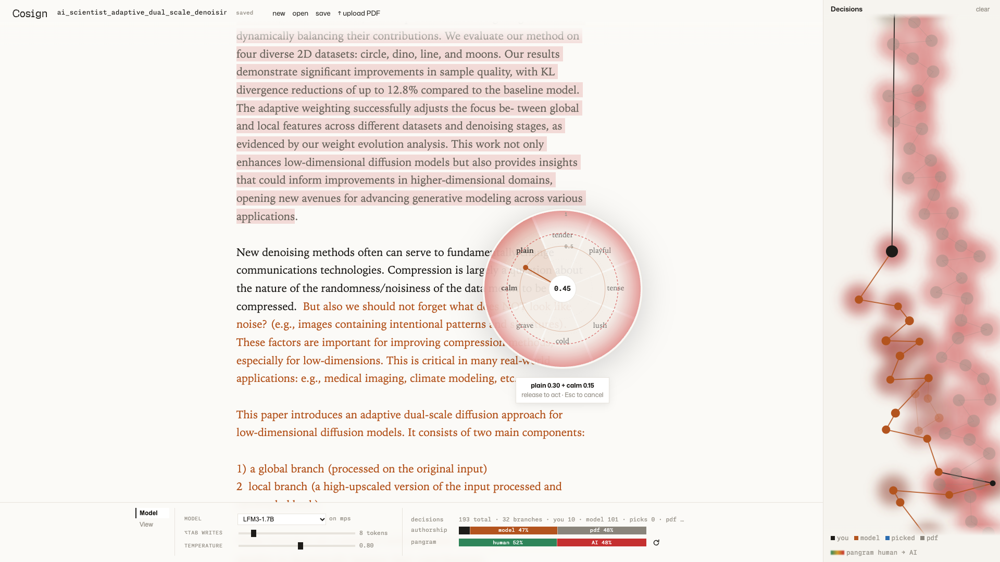

# Cosign

**Co-write with a language model, and steer its mood from inside its weights.**

🏆 First place, Non Slop Hackathon (Pangram, Nous Research, Reducto, Modal; 22 November 2026)

> **🔬 Research in progress: our headline hackathon result has an open question.**
> At the hackathon we reported that co-writing with Cosign's mood dials took an AI-written abstract from 100% to 48% AI on Pangram. We have since tested the dials, and they do not explain that number. The score fell as the AI abstract became a smaller share of the document, and in a small follow-up, freshly steered text placed in the same position was flagged as AI.
>
> What we still can't explain is the result itself. A document that is **94% machine-written** (48% the AI abstract, 46% LFM3, 6% typed) was scored **48% AI** by Pangram, one of the leading AI detectors. Its 1,830 characters of appended text score 1.0 AI on their own and 0.0 after the abstract. We are investigating why ([#16](https://github.com/moonstripe/cosign/issues/16)). The editor and the dials work as described, and several findings still hold. See **[Status of the findings](#status-of-the-findings)** below and [METHODOLOGY.md](METHODOLOGY.md) §6–8.



The shape of AI writing is becoming easily identifiable.

- One problem: the model generates 10x the tokens that a human can.
- Reading every output to ensure authenticity is almost impossible.

Right now, the only options are:

- completely LLM generated: let the agent flow
- opt out completely

This project proposes an alternative take on interacting with artificial intelligence: the user controls how many tokens are generated and can steer them in a direction. By detaching AI writing from its persona as a "useful assistant", there is an opportunity to sit "on the same side" as the model.

The hypothesis: people change mood a little between sentences, and language models write in one voice. Cosign gives the writer a mood dial for every sentence, built into the weights.

## Status of the findings

*Updated 23 November 2026, after an external review ([issues #1–#14](https://github.com/moonstripe/cosign/issues)). This is an interim status, not a conclusion; it will change as the follow-up tests below are run.*

**What we claimed at the hackathon.** Starting from the abstract of a paper written entirely by an AI system (Pangram: 100% AI), one writer co-wrote forward with Cosign: 40 short model writes, 39 of them steered across all eight moods, plus 3 typed edits. Pangram's AI score fell almost steadily to 48%. We presented this as per-sentence mood variation making the text read as less AI.

**Why the dials don't explain it** ([#1](https://github.com/moonstripe/cosign/issues/1), [#2](https://github.com/moonstripe/cosign/issues/2)). Pangram's score is the share of characters that fall in windows it labels AI. The 48% document is 3,537 characters: the 1,707-character abstract plus 1,830 appended. Pangram labelled the original abstract AI (its AI window is characters 0–1,706, the abstract without its final full stop) and **every appended character it scored human**: typed or model-written, steered or not. Its windows cover the first 3,527 characters (the last 10 go unscored), so the score is 1,706 / 3,527 = 0.484. At all 36 scored points on the branch, the score equals the share of the document that is still the original abstract, to within 0.005. So the falling curve measured **dilution**, not the dials: any text Pangram labelled human would have drawn the same curve.

The appended text was not human: 89% of it was written by LFM3 (1,620 of 1,830 characters; the rest is 3 typed edits). **Scored on its own, without the abstract, the same appended text is labelled AI-Generated with a score of 1.0** ([saved response](experiments/detector/n162_appended_alone.json)). It passed only in context, after the strongly AI abstract. Why it passes there is the open question ([#16](https://github.com/moonstripe/cosign/issues/16)). In a small follow-up, every fresh AI text we placed after the same abstract was flagged: LFM3 unsteered or steered, LFM3 as a chat model, and the AI paper's own next sections ([#18](https://github.com/moonstripe/cosign/issues/18)). One likely factor: the editor shows Pangram's live colours, and the writer chose which branches to keep while seeing them, so the kept branch was partly chosen by the detector's own feedback. It was also the lowest score in the whole tree; continuations from that node scored 0.60–0.73.

**The controlled test.** We then scored the generated text **on its own**, so it cannot be diluted. The [design](experiments/detector/PREREG.md) was committed before any data was generated. 10 openings × 2 seeds; Pangram AI score, mean over samples:

| what wrote the text | 150 words | 300 words | 500 words |
|---|---|---|---|
| LFM3, unsteered | 0.82 | 0.89 | 0.91 |
| LFM3, one mood held constant | 0.84 | 0.92 | 0.99 |
| LFM3, **mood changed every sentence** | 0.71 | 0.87 | 0.86 |
| LFM3, mood changed every sentence, incl. reversed dials | 0.77 | 0.98 | 0.97 |
| LFM3 as a chat assistant ("continue this text") | 1.00 | 1.00 | 1.00 |
| human text (2017 paper, 19th-century novels) | 0.00 | 0.00 | 0.00 |

The pre-registered hypothesis, that changing mood every sentence lowers the score against both the unsteered and the constant-mood arms at 300 and 500 words, is **not supported**: the per-sentence arm is 0.04–0.13 lower on average (paired), but every 95% confidence interval includes zero. Many samples ended before 500 words, which leaves only 8–14 matched pairs at the longer lengths. Full results: [experiments/detector/results.md](experiments/detector/results.md).

**What still holds.**

- **The dials are real, measurable edits.** On held-out pairs the tense dial moves the model +1.19 nats/token toward tense text, against +0.02 for a random edit of the same size, with a smooth dose–response. (This check ran inside the programmer agent's own run; see [METHODOLOGY.md](METHODOLOGY.md) §4.3.)
- **Directions read from the model's own text avoid the word-vector failure.** A word vector for "tense" made the model talk about grammar in 20 of 24 samples; the dial did so in 0 of 24.
- **Dropping the assistant persona helps, a little.** Raw continuation scores below the same model used as a chat assistant, which Pangram flagged at 1.00 every time. Only the 150-word difference is clearly distinguishable from noise. Raw continuation is still flagged as AI.
- **The editor works as described:** per-token control, character-level authorship, and the decision tree.

**Other corrections from the review.**

- The anti side of each wedge (calm, cold, grave, plain) runs a dial *in reverse* (negative α), which was tested for only one of the four axes ([#3](https://github.com/moonstripe/cosign/issues/3)). We previously wrote that it was "just the base model"; that was wrong.
- The dial-effect tables compared each dial only against the base model. The lush dial moves the tender word list as much as the tender dial does, so those tables do not show mood-specific effects ([#4](https://github.com/moonstripe/cosign/issues/4)).
- Because of how the dials are built, each is close to a constant multi-layer steering vector. The gain over word vectors comes from *where the direction is read*; it does not yet show that editing weights adds anything ([#8](https://github.com/moonstripe/cosign/issues/8)).
- Smaller factual errors are fixed in METHODOLOGY.md ([#11](https://github.com/moonstripe/cosign/issues/11)). Engineering and security bugs ([#9](https://github.com/moonstripe/cosign/issues/9), [#10](https://github.com/moonstripe/cosign/issues/10), [#12](https://github.com/moonstripe/cosign/issues/12)–[#14](https://github.com/moonstripe/cosign/issues/14)) are open.

**Next.** A larger, separately pre-registered replication of the per-sentence trend; evaluating or disabling the reversed dials; blind multi-judge dial evaluation ([#7](https://github.com/moonstripe/cosign/issues/7)); an ablation of direction source vs weight edit ([#8](https://github.com/moonstripe/cosign/issues/8)).

## How it works

**The model.** [LiquidAI LFM3-1.7B](https://huggingface.co/LiquidAI/LFM3-1.7B) runs locally as a plain text continuer, with no chat template and no system prompt. The assistant persona never shows up. You and the model edit one shared document, and the model writes nothing until you ask. It only sees the text before the cursor, and its token cache re-syncs to that text on every request, so edits anywhere in the document are safe.

**The editor.**

| Key | Action |
|---|---|
| `⌥Tab` | the model writes N tokens at the cursor (N is set in the Model tab) |
| `⇧Tab` | show the top 9 next-token candidates; pick with `1`–`9`; the list reopens until `Esc` |
| `⌘↵` | the model finishes the sentence |
| `Esc` | stop |
| `Tab` | a plain tab (yours) |
| hold `⌥Tab` / `⇧Tab` / `⌘↵` for ~0.2 s | open the **mood wheel** |

- **Mood wheel.** There are four opposed axes: tense ↔ calm, tender ↔ cold, playful ↔ grave and lush ↔ plain. The direction you aim picks the mood (blending between neighbouring wedges), and the distance sets the dial from 0 to 1. Past 0.65 (the red line) the text starts to break. Release to act, or press `Esc` to cancel. For `⌘↵`, macOS only reports releasing `⌘`, so let go of `⌘` to fire. The second mood on each axis (calm, cold, grave, plain) runs that axis's dial in reverse, which is largely untested ([#3](https://github.com/moonstripe/cosign/issues/3)).
- **Authorship.** Every character records who wrote it: black is you, orange is the model, blue is tokens you picked, grey is imported text. The meters show the split.
- **Decision tree** (right panel). Every decision is a node holding a snapshot of the document. Click a node to rewind to it; anything you do next starts a new branch. Hovering a node shows what it changed and, for dial writes, the axis and strength.
- **Pangram.** 2.5 s after you stop editing, the document is checked for AI text. Flagged segments are tinted red (AI) or amber (assisted). Each tree node sits in a cloud coloured by its score, green for human through red for AI. Results are cached by text, and documents under 20 words are skipped. The score covers the whole document, so imported text affects it (see [Status of the findings](#status-of-the-findings)).
- **Reducto.** Upload a PDF and it becomes a linear chain of nodes, one per chunk, each with its own Pangram score. You can then rework it chunk by chunk.
- **Documents.** Documents autosave to the server and can be opened, renamed, deleted or downloaded as `.cosign.json` (everything, including the tree) or `.txt`.

**The dials.** Each mood axis is a rank-1 edit to the MLP down-projections of layers 7–17:

    W' = W + α·A·Bᵀ,   α ∈ [−1, 1] set per token by the wheel (negative = the axis's second mood)

The dials were not trained. Each one was written by an LLM "programmer" agent working in a lab that can read the weights and run 15 forward passes, with no gradients. This follows [*Sparks of Weight-Space Programming*](https://rikiyat.github.io/blog/weight-space-programming/) (MIT CSAIL). Inside its own run, each agent compared its dial with a single random edit of the same size, on its own held-out prompts. The repository-level comparisons do not yet include a random control ([#7](https://github.com/moonstripe/cosign/issues/7)). See [METHODOLOGY.md](METHODOLOGY.md) §4 and [docs/weight-space-programming.md](docs/weight-space-programming.md).

## Quick start

Requirements: Python 3.12 with [uv](https://docs.astral.sh/uv/), Node with [pnpm](https://pnpm.io). The model weights are about 3.5 GB (bf16), downloaded on first run. Runs on Apple silicon (MPS), CUDA or CPU; on an M4 it loads in about 10 s and writes about 20 tokens/s.

```bash
uv sync
cd frontend && pnpm install && pnpm build && cd ..
cp .env.example .env              # optional: Pangram, Reducto, Modal keys
uv run cosign-web                 # http://127.0.0.1:8000
```

Without a Pangram key the editor works but cannot check for AI text. Without a Reducto key, PDF import is off (`.txt` and `.md` import still work).

Open `samples/ai_scientist_branch_48pct.cosign.json` with "open a file…" to explore the hackathon demo branch. Keep in mind that its score curve reflects dilution, not the dials (see above).

Frontend development with hot reload (Vite proxies `/ws` and `/api` to the Python server):

```bash
uv run cosign-web                 # terminal 1, port 8000
cd frontend && pnpm dev           # terminal 2, http://localhost:5173
pnpm test                         # tree-model unit tests (vitest)
```

There is also a terminal client, `uv run cosign --seed 0` (type `:help`). The engine has no UI code and works on its own:

```python
from steer.engine import Engine
e = Engine(seed=0)
e.write("The old lighthouse keeper opened the door and")
e.add_signpost("tense", "calm", strength=5, ttl=15)   # tense dial at 0.5 for 15 tokens
e.generate(20)
print(e.spans())   # [(source, text), ...]
```

## Weight-space programming lab

```bash
uv run wsp-lab --run tense-calm --budget 15          # the lab: model + kernel + forward-pass budget
uv run wsp status | kernel | forward                 # the programmer agent's CLI
scripts/launch-axes.sh tender:cold lush:plain        # one Modal L40S lab per axis (Modal keys in .env)
uv run python -m steer.wsp.compare --help            # held-out head-to-head of dials
```

Submitted dials land in `moods/<concept>__<anti>.pt`, and the editor hot-reloads them.

**Security note.** The lab's kernel runs arbitrary Python with no authentication, and on Modal it is exposed through a public tunnel ([#10](https://github.com/moonstripe/cosign/issues/10)). Only run the lab on infrastructure you control, and stop it when the run ends.

## Repository layout

| Path | Contents |
|---|---|
| `steer/engine.py` | the decode loop: per-token control, cache sync, provenance |
| `steer/dials.py` | dial format and runtime (hooks with per-token α) |
| `steer/server.py` | FastAPI + websocket server; Pangram, Reducto and document endpoints |
| `steer/wsp/` | weight-space programming lab, agent CLI, Modal launcher, task specs, comparison |
| `frontend/` | React + TypeScript editor (Vite, zustand) |
| `moods/` | the four shipped dials |
| `wsp_runs/` | each programmer agent's notes, report, complete tool log and comparisons |
| `experiments/detector/` | the pre-registered detector test: design, script, every sample and every Pangram response |
| `scripts/` | `dial_stats.py` and `branch_stats.py` (recompute the write-up's numbers), Modal helpers |
| `samples/` | the two test PDFs and their Cosign save files |
| `presentation/` | the hackathon deck as presented (open `Cosign deck.html`). Its 48% claim attributes the result to the dials, which our follow-up does not support (see above). |

## Credits

- Built by Kojin Glick with [Hermes Agent](https://hermes-agent.nousresearch.com). The dials were written by LLM programmer agents; their logs are in `wsp_runs/`.
- Model: [LiquidAI LFM3-1.7B](https://huggingface.co/LiquidAI/LFM3-1.7B). AI detection: [Pangram](https://www.pangram.com). PDF parsing: [Reducto](https://reducto.ai). GPUs: [Modal](https://modal.com).
- Method: Takehi, Teoh, Zhang, Khattab, [*Sparks of Weight-Space Programming*](https://rikiyat.github.io/blog/weight-space-programming/) (MIT CSAIL, 2026).
- Sample documents (third-party; included for reproducibility, with their original licences):
  - `samples/ai_scientist_adaptive_dual_scale_denoising.pdf`, generated by [Sakana AI's AI Scientist](https://github.com/SakanaAI/AI-Scientist) (Apache-2.0).
  - `samples/attention_is_all_you_need_2017.pdf`, Vaswani et al., [arXiv:1706.03762v1](https://arxiv.org/abs/1706.03762v1).
- Human control passages in the detector test come from Project Gutenberg (public domain). The script expects them locally and they are not redistributed here.
- The external review in issues #1–#14 found the flaws described above; thank you.

## Acknowledgements

Thank you to [Pangram Labs](https://www.pangram.com), [Nous Research](https://nousresearch.com), [Reducto AI](https://reducto.ai) and [Modal](https://modal.com) for hosting the Non Slop Hackathon, and for the credits that made this project possible.

## License

MIT for the code in this repository; see [LICENSE](LICENSE). The sample documents keep their own licences.
