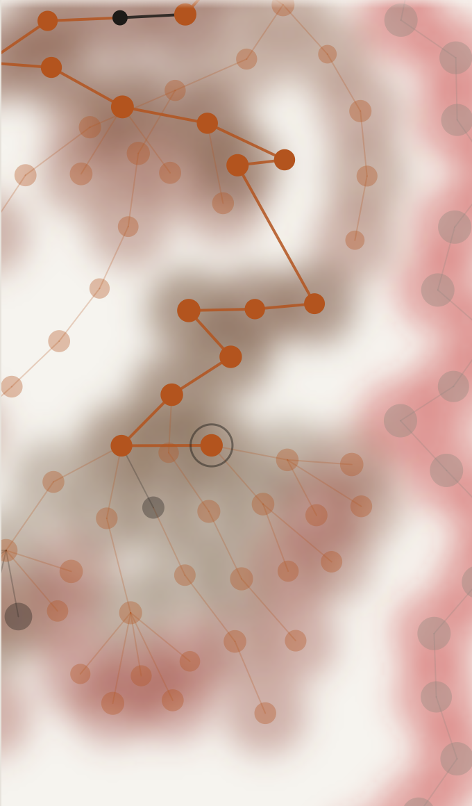

# Cosign

**Co-write with a language model, and steer its mood from inside its weights.**

🏆 First place, Non Slop Hackathon (Nous Research, 22 November 2026)


The shape of AI writing is becoming easily identifiable.

- One problem: the model generates 10x the tokens that a human can.
- Reading every output to ensure authenticity is almost impossible.

Right now, the only options are:

- completely LLM generated: let the agent flow
- opt out completely

This project proposes an alternative take on interacting with artificial intelligence: the user controls how many tokens are generated and can steer them in a direction. By detaching AI writing from its persona as a "useful assistant", there is an opportunity to sit "on the same side" as the model.

## The result

Starting from the abstract of a paper written entirely by an AI system (Pangram: **100% AI**), one writer co-wrote forward with Cosign. They made 40 short model writes, 39 of them steered across all eight moods, plus 3 typed edits. Pangram's AI score fell almost steadily to **48%**.



The hypothesis: people change mood a little between sentences, and language models write in one voice. Cosign gives the writer a mood dial for every sentence, built into the weights.

**[METHODOLOGY.md](METHODOLOGY.md)** covers the whole process: the failed first attempt, the weight-space programming harness, the controls, the experiment, and its limitations. The main open question is whether Pangram has seen LFM3 output at all. Every number in it can be recomputed with the scripts in `scripts/`.

<br clear="right">

## How it works

**The model.** [LiquidAI LFM3-1.7B](https://huggingface.co/LiquidAI/LFM3-1.7B) runs locally as a plain text continuer, with no chat template and no system prompt. The assistant persona never shows up. You and the model edit one shared document, and the model writes nothing until you ask. It only sees the text before the cursor, and its token cache re-syncs to that text on every request, so edits anywhere in the document are safe.

**The editor.**

| Key | Action |
|---|---|
| `⌥Tab` | the model writes N tokens at the cursor (N is set in the Model tab) |
| `⇧Tab` | show the top 9 next-token candidates; pick with `1`–`9`; the list reopens until `Esc` |
| `⌘↵` | the model finishes the sentence |
| `Esc` | stop |
| `Tab` | a plain tab (yours) |
| hold `⌥Tab` / `⇧Tab` / `⌘↵` for ~0.2 s | open the **mood wheel** |

- **Mood wheel.** There are four opposed axes: tense ↔ calm, tender ↔ cold, playful ↔ grave and lush ↔ plain. The direction you aim picks the mood (blending between neighbouring wedges), and the distance sets the dial from 0 to 1. Past 0.65 (the red line) the text starts to break. Release to act, or press `Esc` to cancel. For `⌘↵`, macOS only reports releasing `⌘`, so let go of `⌘` to fire.
- **Authorship.** Every character records who wrote it: black is you, orange is the model, blue is tokens you picked, grey is imported text. The meters show the split.
- **Decision tree** (right panel). Every decision is a node holding a snapshot of the document. Click a node to rewind to it; anything you do next starts a new branch. Hovering a node shows what it changed and, for dial writes, the axis and strength.
- **Pangram.** 2.5 s after you stop editing, the document is checked for AI text. Flagged segments are tinted red (AI) or amber (assisted). Each tree node sits in a cloud coloured by its score, green for human through red for AI. Results are cached by text, and documents under 20 words are skipped.
- **Reducto.** Upload a PDF and it becomes a linear chain of nodes, one per chunk, each with its own Pangram score. You can then rework it chunk by chunk.
- **Documents.** Documents autosave to the server and can be opened, renamed, deleted or downloaded as `.cosign.json` (everything, including the tree) or `.txt`.

**The dials.** Each mood axis is a rank-1 edit to the MLP down-projections of layers 7–17:

    W' = W + α·A·Bᵀ,   α ∈ [0, 1] set per token by the wheel

The dials were not trained. Each one was written by an LLM "programmer" agent working in a lab that can read the weights and run 15 forward passes, with no gradients. This follows [*Sparks of Weight-Space Programming*](https://rikiyat.github.io/blog/weight-space-programming/) (MIT CSAIL). Each dial had to beat a random edit of the same size on held-out prompts. See [METHODOLOGY.md](METHODOLOGY.md) §4 and [docs/weight-space-programming.md](docs/weight-space-programming.md).

## Quick start

Requirements: Python 3.12 with [uv](https://docs.astral.sh/uv/), Node with [pnpm](https://pnpm.io). The model weights are about 3.5 GB (bf16), downloaded on first run. Runs on Apple silicon (MPS), CUDA or CPU; on an M4 it loads in about 10 s and writes about 20 tokens/s.

```bash
uv sync
cd frontend && pnpm install && pnpm build && cd ..
cp .env.example .env              # optional: Pangram, Reducto, Modal keys
uv run cosign-web                 # http://127.0.0.1:8000
```

Without a Pangram key the editor works but cannot check for AI text. Without a Reducto key, PDF import is off (`.txt` and `.md` import still work).

Open `samples/ai_scientist_branch_48pct.cosign.json` with "open a file…" to explore the 48% branch.

Frontend development with hot reload (Vite proxies `/ws` and `/api` to the Python server):

```bash
uv run cosign-web                 # terminal 1, port 8000
cd frontend && pnpm dev           # terminal 2, http://localhost:5173
pnpm test                         # tree-model unit tests (vitest)
```

There is also a terminal client, `uv run cosign --seed 0` (type `:help`). The engine has no UI code and works on its own:

```python
from steer.engine import Engine
e = Engine(seed=0)
e.write("The old lighthouse keeper opened the door and")
e.add_signpost("tense", "calm", strength=5, ttl=15)   # tense dial at 0.5 for 15 tokens
e.generate(20)
print(e.spans())   # [(source, text), ...]
```

## Weight-space programming lab

```bash
uv run wsp-lab --run tense-calm --budget 15          # the lab: model + kernel + forward-pass budget
uv run wsp status | kernel | forward                 # the programmer agent's CLI
scripts/launch-axes.sh tender:cold lush:plain        # one Modal L40S lab per axis (Modal keys in .env)
uv run python -m steer.wsp.compare --help            # held-out head-to-head of dials
```

Submitted dials land in `moods/<concept>__<anti>.pt`, and the editor hot-reloads them.

## Repository layout

| Path | Contents |
|---|---|
| `steer/engine.py` | the decode loop: per-token control, cache sync, provenance |
| `steer/dials.py` | dial format and runtime (hooks with per-token α) |
| `steer/server.py` | FastAPI + websocket server; Pangram, Reducto and document endpoints |
| `steer/wsp/` | weight-space programming lab, agent CLI, Modal launcher, task specs, comparison |
| `frontend/` | React + TypeScript editor (Vite, zustand) |
| `moods/` | the four shipped dials |
| `wsp_runs/` | each programmer agent's notes, report, complete tool log and comparisons |
| `scripts/` | `dial_stats.py` and `branch_stats.py` (recompute the write-up's numbers), Modal helpers |
| `samples/` | the two test PDFs and their Cosign save files |
| `presentation/` | the hackathon deck (open `Cosign deck.html`) |

## Credits

- Built by Kojin Glick with [Hermes Agent](https://hermes-agent.nousresearch.com). The dials were written by LLM programmer agents; their logs are in `wsp_runs/`.
- Model: [LiquidAI LFM3-1.7B](https://huggingface.co/LiquidAI/LFM3-1.7B). AI detection: [Pangram](https://www.pangram.com). PDF parsing: [Reducto](https://reducto.ai). GPUs: [Modal](https://modal.com).
- Method: Takehi, Teoh, Zhang, Khattab, [*Sparks of Weight-Space Programming*](https://rikiyat.github.io/blog/weight-space-programming/) (MIT CSAIL, 2026).
- Sample documents (third-party; included for reproducibility, with their original licences):
  - `samples/ai_scientist_adaptive_dual_scale_denoising.pdf`, generated by [Sakana AI's AI Scientist](https://github.com/SakanaAI/AI-Scientist) (Apache-2.0).
  - `samples/attention_is_all_you_need_2017.pdf`, Vaswani et al., [arXiv:1706.03762v1](https://arxiv.org/abs/1706.03762v1).

## Acknowledgements

Thank you to [Pangram Labs](https://www.pangram.com), [Nous Research](https://nousresearch.com), [Reducto AI](https://reducto.ai) and [Modal](https://modal.com) for hosting the Non Slop Hackathon, and for the credits that made this project possible.

## License

MIT for the code in this repository; see [LICENSE](LICENSE). The sample documents keep their own licences.
