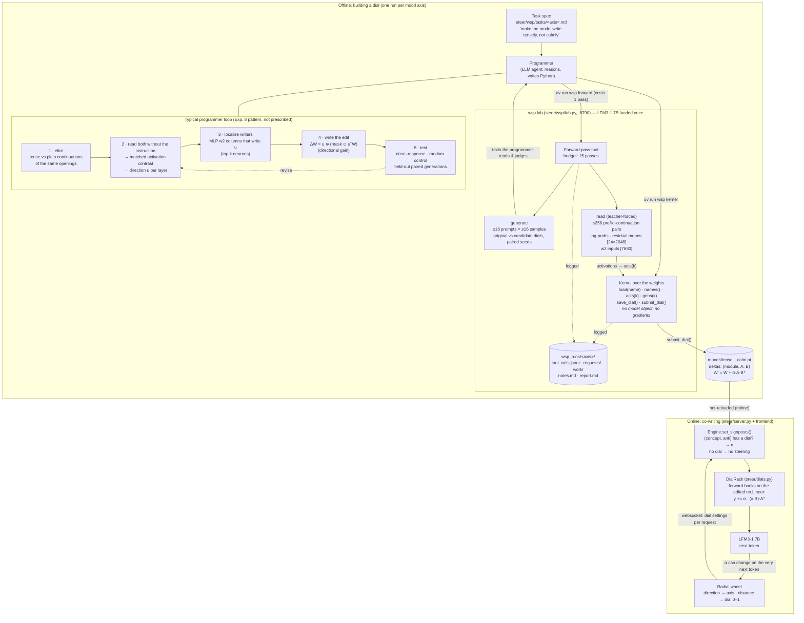

# Weight-space programming for the mood wheel

Each mood axis on the radial wheel (tense ↔ calm, …) is backed by a **dial**: a
low-rank edit to LFM3-1.7B's weights that can be turned between 0 (the
original model) and 1, token by token. Dials are not trained. An LLM
"programmer" writes each one from a plain-English spec. It reads the weights,
runs a limited number of forward passes, and edits the weights in closed form.
This is the setup of *Sparks of Weight-Space Programming* (Takehi, Teoh, Zhang,
Khattab; MIT CSAIL 2026), Experiment 8.

## Pieces

| Piece | File | Role |
| --- | --- | --- |
| Task spec | `steer/wsp/tasks/<axis>.md` | Natural-language goal, tools, rules, deliverables |
| Lab | `steer/wsp/lab.py` (`uv run wsp-lab --run <axis> --budget 15`) | Holds the model; kernel + budgeted forward passes; logs everything |
| Programmer CLI | `steer/wsp/cli.py` (`uv run wsp status\|kernel\|forward`) | The only way the programmer touches the lab |
| Dial format + runtime | `steer/dials.py` | `Dial`, `DialRack` (hooks, per-token α), `bake()` for export |
| Engine integration | `steer/engine.py` | Wheel settings whose (concept, anti) has a dial turn it; there is no other steering |
| Run logs | `wsp_runs/<axis>/` | Every kernel call and forward pass, plus the programmer's notes and report |

## Rules the programmer works under

- No gradients or training: no backward passes, autograd, optimisers, or iterative loss fitting.
  Closed-form linear algebra on weights and recorded activations is allowed.
- The model runs only through the forward-pass tool, which has a fixed budget.
- The embedding, the output head and the final norm are off limits.
- α = 0 is exactly the original model (verified), and α = 1 is the strongest setting the programmer judged
  still fluent.

## Results

The four shipped dials, their evidence and their limits are in [METHODOLOGY.md](../METHODOLOGY.md) §4. Each run's
own report is in `wsp_runs/<axis>/report.md`.
